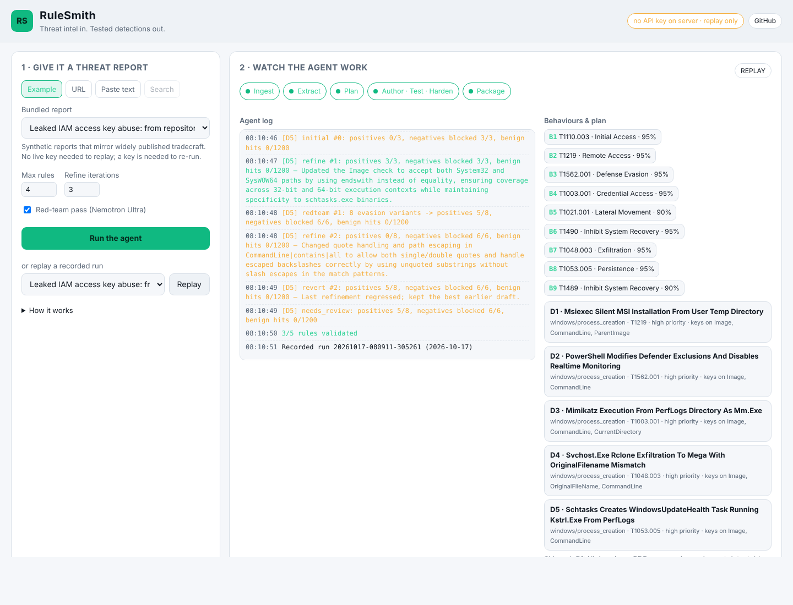

# RuleSmith

**Threat intel in. Tested detections out.**

RuleSmith is an autonomous detection-engineering agent. Give it a threat-intelligence report (a URL, pasted text, or just "latest Qilin ransomware TTPs") and it extracts the attacker behaviours, plans which ones deserve detections, writes Sigma rules *and the test events that prove them*, executes those rules against the tests and a 2,390-event benign baseline, fixes what fails, red-teams its own rules with evasion variants, and ships a deployable pack: Sigma YAML, Splunk SPL, Elastic Lucene, Microsoft KQL, tests, an ATT&CK Navigator layer and an evidence-linked report.

Every model call is an **NVIDIA Nemotron** model served by **Nebius Token Factory**. The web layer is **Tavily**.

Built for the [Nebius x NVIDIA Global AI Hackathon](https://nebiusglobalaihackathon.devpost.com/) (Best Apps and Agents track).

- Hosted demo: [https://huggingface.co/spaces/Arekkusul/rulesmith](https://huggingface.co/spaces/Arekkusul/rulesmith) (static replay of four recorded runs; live runs need a key, see below)
- Demo video: _coming with the submission_
- Plan and research notes: [docs/PLAN.md](docs/PLAN.md) · Tool feedback: [FEEDBACK.md](FEEDBACK.md)



## Why this exists

Turning a vendor report into SIEM detections is a manual, multi-hour job for every SOC on the planet: read the report, work out which behaviours are observable, write the logic, guess the field names, write tests nobody has time for, and hope it is not too noisy. Microsoft's **CTI-REALM** benchmark (March 2026) measures exactly this workflow and frontier models score around 0.64. Published systems (LLMCloudHunter, AutoSigma, Sigma-Hunter) all report the same failure modes: invalid YAML, hallucinated fields, wrong log sources, over-broad logic. Their fix is an LLM judge.

RuleSmith's fix is **execution**. A rule is not done when a model says it looks right; it is done when it compiles, fires on every attack event, stays silent on every benign look-alike, and survives a red-team pass.

## How it works

```
 report URL / text / search query
          │
          ▼
 ┌────────────────┐   Tavily Search + Extract (or direct fetch)
 │ 1  Ingest      │
 └───────┬────────┘
         ▼
 ┌────────────────┐   Nemotron 3.5 Lightning · thinking OFF · strict JSON schema
 │ 2  Extract     │   behaviours, ATT&CK ids, observables, evidence quotes, IOCs
 └───────┬────────┘
         ▼
 ┌────────────────┐   Nemotron 3 Ultra · thinking ON
 │ 3  Plan        │   which behaviours deserve rules, logsource, fields, FP risks
 └───────┬────────┘
         ▼   (per candidate, in parallel)
 ┌────────────────┐   Nemotron 3 Super, shown 3 SigmaHQ rules for the same
 │ 4  Author      │   logsource + technique; writes the Sigma rule + positive &
 └───────┬────────┘   negative test events
         ▼
 ┌────────────────┐   NO LLM. pySigma parse · field dictionary · ATT&CK index ·
 │ 5  Validate    │   compile to SQLite · run tests · run 2,390 benign events
 └───────┬────────┘
         ▼ fails?
 ┌────────────────┐   Nemotron 3 Super gets the exact events it got wrong, per
 │ 6  Refine      │   selection and per field (bounded loop, default 3) ──► back to 5
 └───────┬────────┘   may retire a red-team variant it proves unreachable, reason kept
         ▼
 ┌────────────────┐   Nemotron 3 Ultra · thinking ON
 │ 7  Red-team    │   evasion variants (flag aliases, casing, paths, sibling
 └───────┬────────┘   LOLBins) added as tests ──► 5 ──► one more 6 if needed
         ▼
 ┌────────────────┐   Sigma · Splunk · Elastic · KQL · tests.jsonl ·
 │ 8  Package     │   ATT&CK Navigator layer · report.md · zip
 └────────────────┘
```

### Where Nemotron and Token Factory do the work

| Tier | Model (Token Factory id) | Stage | Why this tier |
|---|---|---|---|
| fast | `nvidia/Nemotron-3_5-Lightning` | Extract | 1M context, cheapest, thinking off: structured extraction does not need a trace |
| main | `nvidia/nemotron-3-super-120b-a12b` | Author, Refine | strong tool/JSON adherence for rule YAML + test events; runs most often. Grounded with SigmaHQ examples retrieved per logsource and ATT&CK technique (no fine-tuning: Token Factory lists no Nemotron base for it) |
| reasoning | `nvidia/Nemotron-3-Ultra-550b-a55b` | Plan, Red-team | the two places where judgement matters: what to detect, and how an attacker would evade it |

All calls go through Token Factory's OpenAI-compatible endpoint with `response_format={"type": "json_schema"}` (falling back to `json_object` if a model rejects it) and `chat_template_kwargs.enable_thinking` toggled per stage. Model ids are resolved at startup against `GET /v1/models`, so renames do not break the app. Token usage and estimated cost per tier are shown for every run.

### Where Tavily does the work

- `search` discovers recent reporting for a free-text query ("Qilin ransomware affiliate TTPs"), ranked by score.
- `extract` (advanced depth, markdown) turns vendor blogs and advisories into clean text, far better than scraping.

Without a Tavily key the app still works on URLs (direct fetch) and pasted text; search mode is disabled.

### What "validated" means

A rule is **validated** only if all of these hold:

1. pySigma parses it and the SQLite backend compiles it.
2. Every field exists for that logsource (dictionary of ~110 logsources; unknown fields in core Sysmon categories are errors).
3. Every `attack.tXXXX` tag exists in the current ATT&CK release (867 techniques bundled).
4. Every positive test event matches, including the red-team evasion variants.
5. No negative (benign look-alike) test event matches.
6. Zero hits on the benign baseline corpus for that logsource. The corpus deliberately contains SCCM and Intune running encoded PowerShell, installers writing Run keys, admins running `whoami`/`net`/`schtasks`, and `rundll32` launching real control-panel DLLs. A rule that cannot tell those apart is **needs_review**, not validated.

The validator is the same approach Zircolite uses on real EVTX data, so passing here means the rule behaves the same way in production.

## Quick start

```bash
git clone https://github.com/Arekkusul/nebius-nvidia-hackathon.git
cd nebius-nvidia-hackathon
python -m venv .venv && source .venv/bin/activate
pip install -e ".[dev]"

cp .env.example .env         # add NEBIUS_API_KEY (and TAVILY_API_KEY if you have one)
rulesmith models             # shows which Nemotron model each tier resolved to
rulesmith run --example macro_loader_campaign --out ./pack
rulesmith serve              # web UI on http://localhost:7860
```

Get a Token Factory key at https://tokenfactory.nebius.com (hackathon credits: code `NEBIUS-DEVPOST-GLOBAL26`). Get a Tavily key at https://app.tavily.com.

### Docker

```bash
docker build -t rulesmith .
docker run -p 7860:7860 -e NEBIUS_API_KEY=... -e TAVILY_API_KEY=... rulesmith
```

### Hosted demo on Hugging Face Spaces

Two options. The **static Space** is free and is what the demo link above points to: the same UI in replay-only mode, serving the recorded runs from `examples/runs/` as split JSON files (no server, no keys, no cost).

```bash
python deploy/huggingface/build_static.py            # writes deploy/huggingface/static_site/
# upload that directory to a Space created with "sdk: static" (web UI drag-and-drop or huggingface-cli upload)
```

The **live Space** runs the full agent on a free CPU Space created with the Gradio SDK (the SDK only decides how the Space is launched; `deploy/huggingface/live/app.py` starts the FastAPI app itself). It installs the package from this repository, so the repository must be public:

1. Create a Space with `sdk: gradio` and upload the three files in `deploy/huggingface/live/` (`README.md`, `app.py`, `requirements.txt`).
2. Add the secrets `NEBIUS_API_KEY` (required), `TAVILY_API_KEY` (optional, enables URL extraction and search) and `RULESMITH_DEMO_BUDGET_USD` (for example `5`).

With a budget set, visitors can analyse their own URLs, text or queries: each run is capped at `RULESMITH_DEMO_MAX_RULES` (default 3) rules, the health pill shows how much of the budget is left, and once it is spent new runs are refused with a clear message while the recorded replays keep working. `RULESMITH_DEMO_LOCKED=true` is the stricter alternative: bundled example reports and replays only.

A **Docker Space** (`HF_TOKEN=hf_... ./deploy/huggingface/push_space.sh <user>/rulesmith`) does the same from the Dockerfile but needs a Hugging Face PRO plan.

### CLI

```
rulesmith run --example <id> [--out DIR] [--max-rules N] [--iterations N] [--no-redteam] [--json]
rulesmith run --url https://... [--url https://...]
rulesmith run --query "Scattered Spider help-desk social engineering 2026"
rulesmith run --text-file report.md
rulesmith examples
rulesmith models
rulesmith serve [--port 7860]
```

### API

| Method | Path | Purpose |
|---|---|---|
| GET | `/api/health` | configured keys, resolved models |
| GET | `/api/examples` | bundled example reports |
| POST | `/api/runs` | start a run `{mode: url|text|query|example, value, urls, max_rules, max_refine_iterations, enable_redteam}` |
| GET | `/api/runs/{id}/events` | Server-Sent Events stream of the agent's progress |
| GET | `/api/runs/{id}` | status and full result JSON |
| GET | `/api/runs/{id}/download` | zip pack |
| GET | `/api/runs/{id}/report.md` · `/navigator.json` | report, ATT&CK Navigator layer |
| GET | `/api/replays` · `/api/replays/{id}` | recorded runs for the demo |

Interactive docs at `/api/docs`.

## Evaluation

`python eval/run_eval.py --record` runs the five bundled reports (Windows loader, ransomware affiliate, Linux cryptominer, AWS credential abuse, LSASS/lateral movement) and writes `eval/results.md`. The table reports, per report: behaviours extracted, rules written, rules validated, first-try pass rate, attack events caught, benign look-alikes blocked, baseline false positives, refine cycles, red-team variants, tokens and cost.

Results from the recorded runs (18 Oct 2026, Lightning / Super 120B / Ultra 550B on Token Factory; also in [eval/results.md](eval/results.md)):

| Report | Behaviours | Rules | Validated | First-try pass | Attack events caught | Benign look-alikes blocked | Baseline FPs | Refine cycles | Red-team variants | Retired / corrected tests | Tokens in/out | Est. cost | Wall time |
|---|---|---|---|---|---|---|---|---|---|---|---|---|---|
| aws_credential_abuse | 8 | 5 | 2 | 1 | 95% | 76% | 0 | 21 | 28 | 0 / 0 | 120,076/30,161 | $0.099 | 72s |
| linux_cryptominer_docker | 10 | 5 | 4 | 1 | 92% | 100% | 0 | 17 | 39 | 0 / 0 | 103,709/39,420 | $0.132 | 70s |
| lsass_dump_lateral_movement | 8 | 5 | 2 | 0 | 92% | 87% | 0 | 23 | 40 | 0 / 0 | 138,449/53,912 | $0.183 | 102s |
| macro_loader_campaign | 7 | 5 | 2 | 2 | 68% | 100% | 0 | 21 | 41 | 0 / 0 | 140,470/53,718 | $0.180 | 93s |
| ransomware_affiliate_intrusion | 9 | 5 | 5 | 5 | 100% | 100% | 0 | 6 | 39 | 0 / 0 | 55,858/42,549 | $0.133 | 70s |
| **Total** | 42 | 25 | 15 (60%) | 9 | | | 0 | 88 | 187 | 0 / 0 | 558,562/219,760 | $0.728 | 407s |

How to read it:

- **Validated** is the strict definition above: parses, compiles, every positive and negative test right, every red-team variant caught, zero hits on the benign corpus. The other rules are **needs_review**: they parse and compile, stayed silent on the benign corpus, and ship with the exact tests they miss and a per-selection, per-field explanation of why. Most of what remains is a rule whose own first-draft tests disagree with it (the model's test events describe a parent the rule never keys on, or an encoded command the rule expects in clear) that three refine rounds did not reconcile.
- **Baseline FPs** is zero across all 25 rules: no generated rule fires on the 2,390-event benign corpus (SCCM encoded PowerShell, installers writing Run keys, admins running discovery commands, control-panel `rundll32`).
- **First-try pass** is how many rules were already validated before any refinement: 8 of 25 before SigmaHQ grounding, 9 to 13 of 25 across the three grounded runs (Super is non-deterministic, so expect a swing of a few rules between runs).
- **Red-team variants** counts the evasion tests the Ultra red-team added. **Retired / corrected** counts, in the open, the two ways the refine stage may change the test set instead of the rule: a red-team variant retired as unreachable for the logsource (an 8.3 short-name path, a UNC path, swapped parent/child fields), and a test event corrected because the event itself was wrong (a missing `ParentImage`). Both keep the original and the reason on the rule, in the report and in the UI. The author's own tests can never be retired, red-team variants can never be corrected (only retired), at most half of the red-team tests can be retired, a corrected positive may only add fields its sibling events already carry, and at most two events are corrected per pass. The recorded run needed neither; earlier runs retired 4 and corrected 1.
- A full five-report run costs about $0.73 and seven minutes; Ultra (planning and red-team) is roughly half the spend.

The same harness scored 6 of 25 before the fixes the first live runs prompted (structured rule output, event normalisation, per-selection diagnostics, the correlation lint), 12 of 25 after them, and 13 to 15 of 25 across three runs with SigmaHQ grounding, test retirement and correction, and the deterministic repairs (missing `condition`, stray quotes in field keys, a multi-step chain reduced to one step, `contains|all` lists reconciled with the positives). The recorded runs reflect the current code.

## Repository layout

```
rulesmith/
  config.py        settings, model tiers, pricing
  llm.py           Token Factory client (json_schema + fallback, thinking toggle, repair, usage)
  models.py        pydantic schemas = JSON schemas handed to Nemotron
  prompts.py       stage prompts and the Sigma cheat-sheet
  ingest.py        Tavily search/extract, direct fetch fallback
  extract.py plan.py author.py refine.py redteam.py   the five Nemotron stages
  sigmahq.py       few-shot retrieval from the SigmaHQ rule index (logsource + technique + title words)
  validate/        sigma_check.py fields.py attack.py runner.py (SQLite) corpus.py
  convert.py       pySigma backends: Splunk, Elastic, Kusto, SQLite
  package.py       Navigator layer, report.md, zip
  pipeline.py      orchestrator + event stream + metrics
  cli.py           command line
  server/          FastAPI API + static UI
data/              benign_corpus.jsonl (2,390 events), field_schemas.json, attack_techniques.json, sigmahq_examples.json (3,155 slimmed SigmaHQ rules, DRL 1.1)
examples/reports/  five synthetic reports for offline demo and eval
examples/runs/     recorded runs used by replay mode
eval/              benchmark harness
scripts/           corpus, ATT&CK index and SigmaHQ example index generators
tests/             80 tests (75 offline, 5 live smoke tests skipped without keys)
```

## Testing

```bash
pytest -q
```

The suite covers the Token Factory client (JSON-mode fallback, repair loop, model resolution), every validator component (including the per-selection miss diagnostics), the SQLite runner, the event normaliser (double-escaped paths, defanged indicators), ingestion with Tavily mocked, the full pipeline through a scripted fake model (including a too-broad rule that must be refined using benign-corpus evidence, a red-team variant that forces a hardening pass, and a refinement that regresses and is rolled back), conversions, packaging, the API including the SSE stream, and the CLI. `pytest tests/test_live.py -s` runs the live smoke test when `NEBIUS_API_KEY` and `TAVILY_API_KEY` are set.

## Limitations and honest notes

- Test events and the benign corpus are synthetic. The corpus is realistic and adversarially chosen, but a rule that passes here still deserves a look at your own telemetry before it goes to production. That is why the pack ships the tests: run them against your SIEM.
- The field dictionary covers ~110 logsources. For logsources it does not know, field names are not checked (reported as info).
- Extraction is only as good as the report. Marketing-heavy posts with no concrete observables produce few detectable behaviours, and the agent will say so.
- KQL conversion uses the Microsoft Defender XDR pipeline; logsources it does not map (e.g. `wmi_event`) report a conversion error for that target only.

## License

MIT. See [LICENSE](LICENSE).
